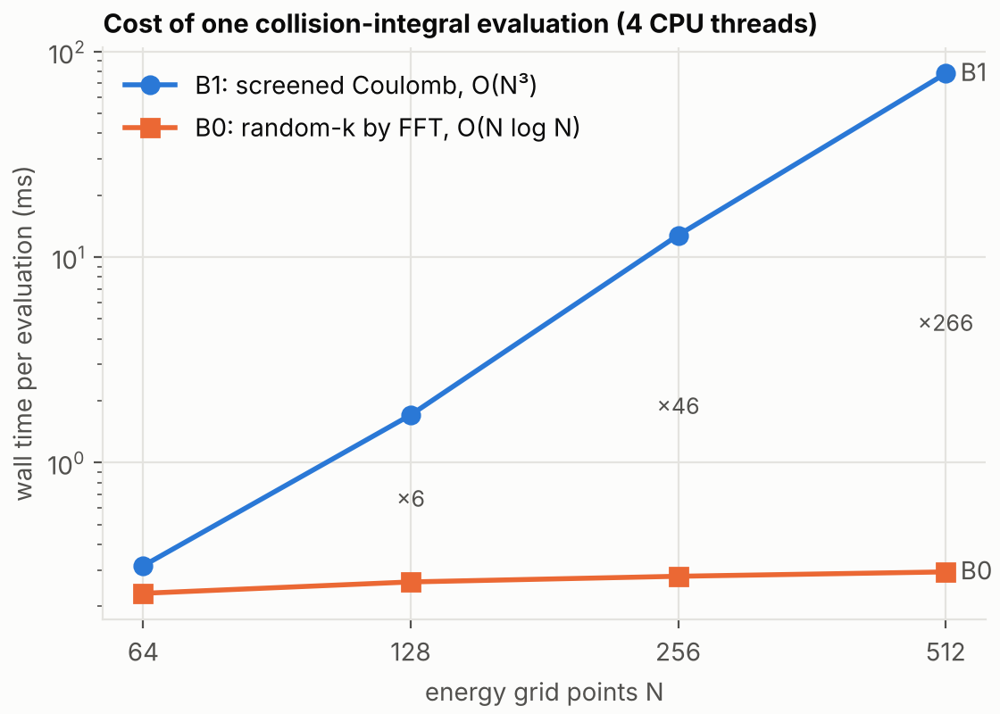
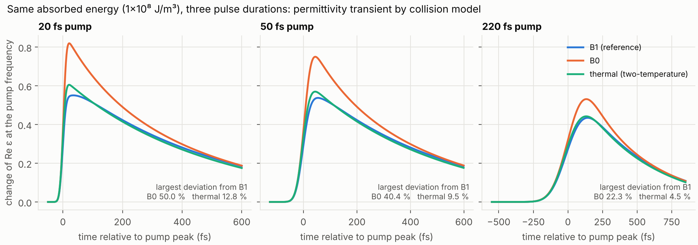

# Gate 1 report: is a learned surrogate of the collision integral needed?

Date 2026-11-17 · scripts `scripts/gate1_benchmark.py`, `scripts/make_figures.py` · data `results/wp1/gate1.json`, `results/wp1/gate1_series.npz`

## Verdict

**Gate 1 does not pass as written. The exact collision integral is cheaper than the plan assumed, and the cheap baseline it was to be compared with is not accurate enough to use.**

The plan's criterion has two parts, and they point in opposite directions:

| Criterion | Result |
| --- | --- |
| B1 costs at least 100× more per evaluation than B0 | **Only at 512 energy points** (×266). At 256 points ×46, at 128 points ×6. |
| B0 misses B1's permittivity transient by more than 2 % | **Yes, everywhere**: 7.3–221.0 % on Re ε, 3.2–46.9 % on ω_p², over 16 excitation conditions. |

And the resolution that decides the first row: **128 points reproduce the 256-point B1 transient to 0.2 % or better in every observable** (one condition tested). At 128 points one B1 evaluation takes 1.7 ms on four CPU cores.

What follows from this:

1. **The plan's fallback ("use FFT-evaluated B0 inside WP3") should not be taken.** B0 overestimates the permittivity transient by tens of per cent and more.
2. **WP3 can run on the exact integral B1.** A film run of the plan's size (100 cells × 10⁴ kinetic steps = 10⁶ evaluations) costs about 28 minutes at 128 points, 3.5 hours at 256 and 22 hours at 512 on this 4-core machine. The plan assumed 1–10 days.
3. **The surrogate is not needed for the flagship physics (WP3, H3). Its case rests on WP4**, which needs 10³–10⁴ film runs: 473–4734 hours on this machine at 128 points. Before training anything, port B1 to a GPU (it is a dense contraction over three indices, 2×10⁶ multiply–adds at N = 128, and batches over cells) and measure again. The WP2 acceptance criterion "≥100× faster than B1 at 512 points" should be restated against that GPU baseline at the resolution actually needed.
4. This is the outcome the plan names as its largest risk. Its consequence there stands: the Maxwell–kinetic physics carries the flagship paper; the operator moves to the methods paper and to inference speed, if a GPU B1 leaves a gap.

The decision on point 3 is the project lead's; the measurements below are what it should rest on.

## A. Cost per evaluation

4 numba threads, Linux-6.18.44-fc-v553-x86_64-with-glibc2.39. B1 timings include rebuilding its lookup tables for a new screening wavevector, as happens at every call in a run.

| N | B1 (ms) | B0 (ms) | ratio |
| --- | --- | --- | --- |
| 64 | 0.31 | 0.231 | 1 |
| 128 | 1.70 | 0.262 | 6 |
| 256 | 12.77 | 0.280 | 46 |
| 512 | 78.19 | 0.294 | 266 |

B1 scales as N³ and B0 is flat (FFT overhead dominates below N = 512). No GPU was available, so the "batched on one GPU" figure of the plan is still to be measured.

## B. Accuracy of the cheaper models against B1

Same excitation run with B1, B0, a number- and energy-conserving relaxation-time model (RTA) and the thermal two-temperature model, at N = 128, 1300 nm. "Energy" mode gives every model the same absorbed power p_abs(t), isolating the kinetics; "field" mode gives the same in-film field, so each model absorbs through its own ε″(t). The miss of a model is max_t |y − y_B1| divided by the size of B1's own transient, max_t |y_B1 − y_B1(t₀)|.

| Drive | Pulse (fs) | Level | T_e,max, B1 (K) | B0: Re ε (%) | B0: ω_p² (%) | RTA: Re ε (%) | Thermal: Re ε (%) | Thermal: ω_p² (%) |
| --- | --- | --- | --- | --- | --- | --- | --- | --- |
| energy | 20 | 3×10^7 J/m³ | 2202 | 16.5 | 9.2 | 15.1 | 11.9 | 12.6 |
| energy | 20 | 1×10^8 J/m³ | 4309 | 50.0 | 10.5 | 26.8 | 12.8 | 13.1 |
| energy | 20 | 3×10^8 J/m³ | 10131 | 129.8 | 9.0 | 82.2 | 11.2 | 10.0 |
| energy | 50 | 3×10^7 J/m³ | 2117 | 13.6 | 7.8 | 12.9 | 8.9 | 9.4 |
| energy | 50 | 1×10^8 J/m³ | 4118 | 40.4 | 8.1 | 21.6 | 9.5 | 9.8 |
| energy | 50 | 3×10^8 J/m³ | 9265 | 123.9 | 6.8 | 67.8 | 8.0 | 7.6 |
| energy | 100 | 3×10^7 J/m³ | 2004 | 10.6 | 6.3 | 10.4 | 6.1 | 6.5 |
| energy | 100 | 1×10^8 J/m³ | 3878 | 32.0 | 6.0 | 17.1 | 7.0 | 7.3 |
| energy | 100 | 3×10^8 J/m³ | 8300 | 117.2 | 5.0 | 54.6 | 5.7 | 5.6 |
| energy | 220 | 3×10^7 J/m³ | 1802 | 7.3 | 4.6 | 7.6 | 3.0 | 3.2 |
| energy | 220 | 1×10^8 J/m³ | 3472 | 22.3 | 4.1 | 12.6 | 4.5 | 4.7 |
| energy | 220 | 3×10^8 J/m³ | 6947 | 99.1 | 3.2 | 38.6 | 3.6 | 3.7 |
| field | 20 | 100 GW/cm² in-film | 2728 | 36.3 | 20.8 | 28.5 | 14.4 | 15.1 |
| field | 20 | 500 GW/cm² in-film | 9684 | 171.3 | 42.7 | 163.3 | 16.7 | 14.6 |
| field | 220 | 10 GW/cm² in-film | 2355 | 16.6 | 8.9 | 16.3 | 4.8 | 5.1 |
| field | 220 | 40 GW/cm² in-film | 6071 | 221.0 | 46.9 | 126.2 | 4.8 | 4.9 |

Reading:

- **B0 fails mainly through the collision rate, not the distribution.** Its error on ω_p², which depends only on f, is 3.2–10.5 % at equal absorbed power; its error on Re ε is several times larger because ε also depends on the damping η(E), and B0's rate grows with the cube of the Kane density of states (twice B1's at μ + 0.5 eV, more above). In field mode the wrong ε″ also changes how much is absorbed, and the error compounds (up to 221.0 %).
- **Whatever replaces B1 must reproduce the collision rate as well as the collision term.** A learned operator that outputs only Q[f] would not be enough; it needs η(E) too, or the damping model must be revisited ([16] argues only Umklapp e–e events should damp the polarisation).
- **The thermal model is the best cheap model**: 3.0–16.7 % on Re ε, worst for the shortest pulses and falling to 3–5 % at 220 fs. That residual is the non-thermal contribution hypothesis H1 is about; it is what the kinetic model adds for pulses of 20–50 fs.
- The conserving RTA (7.6–163.3 %) is no better than B0.

## C. Grid check

B1, 50 fs, 10⁸ J/m³ absorbed, N = 128 against N = 256 (linear optics calibrated on the N = 128 grid for both):

| Observable | miss (%) |
| --- | --- |
| eps_re | 0.14 |
| eps_im | 0.22 |
| wp2 | 0.16 |
| gamma | 0.14 |
| T_e | 0.14 |

A first version of this check failed for ε″ and the damping (tens of per cent) and exposed an under-resolved electron–phonon collision rate; that was a defect in the rate formula, now fixed (working log §1.4). With the fix the optical-average rate is identical from N = 64 to 1024.

## Limits of this measurement

- CPU only, one machine. The absolute times will change on other hardware; the N³ scaling will not.
- The grid check covers one condition, with T_e,max ≈ 4100 K. Weak excitation keeps a sharp Fermi edge (k_BT = 26 meV against ΔE = 31 meV at N = 128) and may need a finer grid; a convergence sweep over the case matrix at N = 128, 256, 512 is the first follow-up.
- All runs use the 4 eV band; the benchmark levels were kept inside what that band can hold (working log §1.5). The comparison should be repeated with the 6 eV band before the dataset is generated.
- B0 was matched to B1 at the Fermi-liquid limit. A B0 with a fitted, energy-dependent matrix element might do better; that would be a different model from [40]'s.
- Parameters are the reference set of [14, 15] with c_ee = 3/16. A larger e–e prefactor shortens thermalisation and shrinks the thermal model's miss; the conclusion about B0 does not depend on it.
