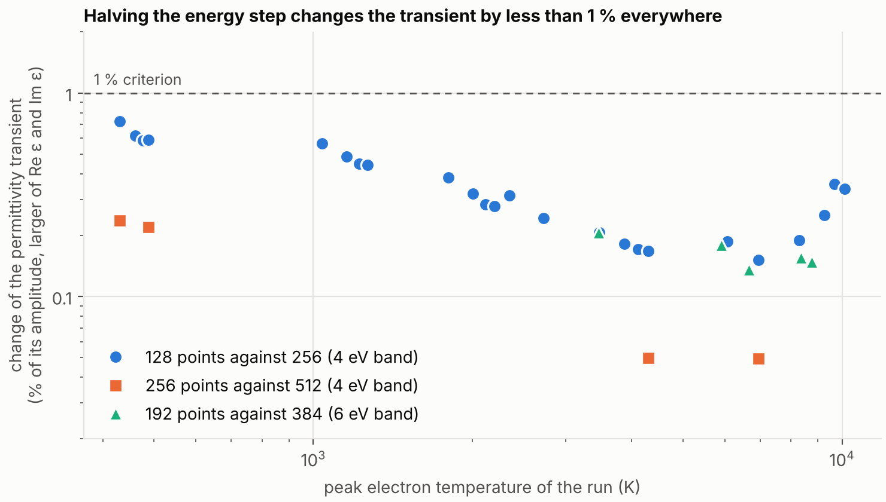
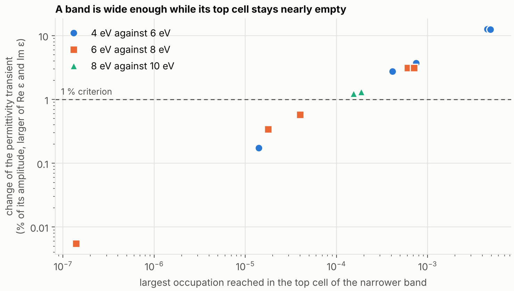

# Gate 1b report: is the exact solver affordable across the whole condition matrix?

Generated by `scripts/make_g1b_report.py` from `results/wp1/convergence_sweep.json`, `gate1.json` and `bench_b1_jax_*.json`. Do not edit by hand.

## Verdict

| Part of the criterion (plan revision 2) | Result |
| --- | --- |
| 128 or 256 points reproduce the finest grid within 1 % of the transient amplitude over the whole matrix, including weak excitation | **met at 128 points, without margin at the weakest excitation.** 128 points: at most 0.72 % (220 fs, 1 × 10^6 J/m³ absorbed) against 256 points over all 24 conditions, and 0.96 % (220 fs, 1 × 10^6 J/m³ absorbed) against 512 points. 256 points: at most 0.24 % (220 fs, 1 × 10^6 J/m³ absorbed) against 512 points; extrapolated to zero energy step (observed order 1.3–1.7) the 128-point error is 1.1 % and the 256-point error 0.4 % in the worst case |
| … and with the 6 eV band | **met for the grid:** 192 points differ from 384 by at most 0.21 % (220 fs, 1 × 10^8 J/m³ absorbed). **The band width itself is the larger error** at strong excitation, see section B |
| A film run on the exact integral fits in hours on a cluster node | **met:** 1.7 core-hours at 128 points, 4.4 core-hours at 192 points, 12.0 core-hours at 256 points; the cells of a film run in parallel |
| … or minutes on a GPU | **outstanding** (no GPU in this environment) |

In short: the energy step is not the problem. A step of 31 meV (128 points per 4 eV) sits at the 1 % line for the weakest excitation (a temperature rise of 131–188 K) and improves from there: against the next finer grid the difference is 0.7 % at worst and 0.4 % or less for every run that peaks above 1800 K. What limits accuracy at strong excitation is the upper cut-off of the band, and the grid has to grow with it.

## A. Energy step, 4 eV band

"Miss" is the largest deviation of the transient y(t) − y(t₀) from that of a finer grid, as a percentage of the finer grid's transient amplitude; the table gives the largest of Re ε, Im ε and ω_p². All runs use the exact integral, one material, 1300 nm. "Field" levels are a fixed in-film intensity; the thin-film (self-consistent) drive is not part of this sweep.

| Drive | Pulse (fs) | Level | T_e,max (K) | 128 vs 256 pts (%) | 128 vs 512 pts (%) | 256 vs 512 pts (%) |
| --- | --- | --- | --- | --- | --- | --- |
| absorbed energy | 20 | 1 × 10^6 J/m³ absorbed | 488 | 0.59 | 0.78 | 0.22 |
| absorbed energy | 20 | 1 × 10^7 J/m³ absorbed | 1266 | 0.44 | — | — |
| absorbed energy | 20 | 3 × 10^7 J/m³ absorbed | 2201 | 0.28 | — | — |
| absorbed energy | 20 | 1 × 10^8 J/m³ absorbed | 4306 | 0.17 | 0.22 | 0.05 |
| absorbed energy | 20 | 3 × 10^8 J/m³ absorbed | 10119 | 0.34 | — | — |
| absorbed energy | 50 | 1 × 10^6 J/m³ absorbed | 477 | 0.58 | — | — |
| absorbed energy | 50 | 1 × 10^7 J/m³ absorbed | 1220 | 0.45 | — | — |
| absorbed energy | 50 | 3 × 10^7 J/m³ absorbed | 2116 | 0.28 | — | — |
| absorbed energy | 50 | 1 × 10^8 J/m³ absorbed | 4117 | 0.17 | — | — |
| absorbed energy | 50 | 3 × 10^8 J/m³ absorbed | 9263 | 0.25 | — | — |
| absorbed energy | 100 | 1 × 10^6 J/m³ absorbed | 461 | 0.62 | — | — |
| absorbed energy | 100 | 1 × 10^7 J/m³ absorbed | 1157 | 0.49 | — | — |
| absorbed energy | 100 | 3 × 10^7 J/m³ absorbed | 2003 | 0.32 | — | — |
| absorbed energy | 100 | 1 × 10^8 J/m³ absorbed | 3876 | 0.18 | — | — |
| absorbed energy | 100 | 3 × 10^8 J/m³ absorbed | 8296 | 0.19 | — | — |
| absorbed energy | 220 | 1 × 10^6 J/m³ absorbed | 431 | 0.72 | 0.96 | 0.24 |
| absorbed energy | 220 | 1 × 10^7 J/m³ absorbed | 1039 | 0.57 | — | — |
| absorbed energy | 220 | 3 × 10^7 J/m³ absorbed | 1800 | 0.39 | — | — |
| absorbed energy | 220 | 1 × 10^8 J/m³ absorbed | 3470 | 0.21 | — | — |
| absorbed energy | 220 | 3 × 10^8 J/m³ absorbed | 6942 | 0.15 | 0.20 | 0.05 |
| field | 20 | 100 GW/cm² in the film | 2727 | 0.24 | — | — |
| field | 20 | 500 GW/cm² in the film | 9675 | 0.36 | — | — |
| field | 220 | 10 GW/cm² in the film | 2353 | 0.31 | — | — |
| field | 220 | 40 GW/cm² in the film | 6066 | 0.19 | — | — |



- The error falls with excitation: the cold Fermi edge (k_B T = 26 meV at 300 K) is the sharpest feature the grid has to resolve, and it is as narrow as one 128-point cell (31 meV). Above 1000 K the 128-point grid differs from the 256-point grid by at most 0.57 % (220 fs, 1 × 10^7 J/m³ absorbed).
- The error is a scale error, not a shape error: T_e, ω_p², Re ε and Im ε all miss by the same fraction, as expected from a quadrature error in the heat capacity.
- **Static offset.** The cold-state permittivity itself differs between grids by a constant (-1.0e-03 in Re ε and +8.9e-05 in Im ε at 128 points, -2.7e-04 and +2.2e-05 at 256 points, against 512). It is the same for every condition and is removed when ε∞ and the impurity rate are calibrated on the grid in use (`enzkin.calibrate`). Carried from one grid to another it is up to 24 % of the weakest transient in the table, which is how the first pass of this sweep appeared not to converge.

## B. The 6 eV band, and how wide the band has to be

Strong-excitation conditions rerun with a 6 eV band at the same energy step (192 points) and at half the step (384 points):

| Drive | Pulse (fs) | Level | T_e,max (K) | 192 vs 384 pts: Re ε (%) | Im ε (%) |
| --- | --- | --- | --- | --- | --- |
| absorbed energy | 20 | 3 × 10^8 J/m³ absorbed | 8755 | 0.09 | 0.15 |
| absorbed energy | 220 | 1 × 10^8 J/m³ absorbed | 3468 | 0.21 | 0.21 |
| absorbed energy | 220 | 3 × 10^8 J/m³ absorbed | 6674 | 0.12 | 0.14 |
| field | 20 | 500 GW/cm² in the film | 8373 | 0.12 | 0.16 |
| field | 220 | 40 GW/cm² in the film | 5917 | 0.16 | 0.18 |

**Band width.** Runs with the same energy step and different band width; the narrower band is measured against the wider one with the same "miss". The top-cell occupation is the largest value f reaches in the last cell of the narrower band.

| Band (eV) | Drive | Pulse (fs) | Level | T_e,max narrow (K) | T_e,max wide (K) | top-cell occupation | effect on Re ε (%) | on Im ε (%) | on T_e (%) |
| --- | --- | --- | --- | --- | --- | --- | --- | --- | --- |
| 4 → 6 | absorbed energy | 220 | 1 × 10^8 J/m³ absorbed | 3472 | 3471 | 1 × 10^-5 | 0.2 | 0.2 | 0.0 |
| 4 → 6 | field | 220 | 40 GW/cm² in the film | 6072 | 5922 | 4 × 10^-4 | 2.3 | 2.7 | 2.7 |
| 4 → 6 | absorbed energy | 220 | 3 × 10^8 J/m³ absorbed | 6947 | 6678 | 7 × 10^-4 | 2.8 | 3.7 | 4.2 |
| 4 → 6 | field | 20 | 500 GW/cm² in the film | 9685 | 8376 | 5 × 10^-3 | 11.0 | 12.6 | 16.2 |
| 4 → 6 | absorbed energy | 20 | 3 × 10^8 J/m³ absorbed | 10120 | 8756 | 5 × 10^-3 | 9.8 | 12.5 | 16.1 |
| 6 → 8 | absorbed energy | 220 | 1 × 10^8 J/m³ absorbed | 3471 | 3471 | 1 × 10^-7 | 0.0 | 0.0 | 0.0 |
| 6 → 8 | field | 220 | 40 GW/cm² in the film | 5922 | 5916 | 2 × 10^-5 | 0.3 | 0.3 | 0.1 |
| 6 → 8 | absorbed energy | 220 | 3 × 10^8 J/m³ absorbed | 6678 | 6663 | 4 × 10^-5 | 0.5 | 0.6 | 0.2 |
| 6 → 8 | field | 20 | 500 GW/cm² in the film | 8376 | 8242 | 6 × 10^-4 | 3.1 | 3.0 | 1.7 |
| 6 → 8 | absorbed energy | 20 | 3 × 10^8 J/m³ absorbed | 8756 | 8610 | 7 × 10^-4 | 3.1 | 3.0 | 1.8 |
| 8 → 10 | field | 20 | 500 GW/cm² in the film | 8242 | 8224 | 2 × 10^-4 | 1.2 | 1.1 | 0.2 |
| 8 → 10 | absorbed energy | 20 | 3 × 10^8 J/m³ absorbed | 8610 | 8593 | 2 × 10^-4 | 1.3 | 1.1 | 0.2 |



- **4 eV band** (against 6 eV): within 1 % up to a peak temperature of 3471 K; off by 2.7 % at 5922 K and by 12 % at 8756 K.
- **6 eV band** (against 8 eV): within 1 % up to a peak temperature of 6663 K; off by 3.1 % near 8400 K.
- **8 eV band** (against 10 eV): off by 1.3 % near 8400 K.

The three band pairs fall on one curve when plotted against the occupation of the narrower band's top cell: the change stays below 1 % while that cell never fills beyond 4 × 10^-5, and exceeds 1 % from 2 × 10^-4 upward. Every run records this number (`f_top_max`), so it serves as the test: **widen the band when the top-cell occupation passes 4 × 10^-5.**

For the hottest condition the change shrinks with each widening (12.6 % from 4 to 6 eV, 3.1 % from 6 to 8 eV, 1.2 % from 8 to 10 eV), so the cut-off dependence converges, but slowly.

Two cautions. A narrow band always errs in the same direction: electrons that cannot go higher pile up below the cut-off, so the temperature and the transient are overestimated. And these are statements about the numerical cut-off. The Kane dispersion several eV above the Fermi level is an extrapolation, not the band structure of ITO, so the sensitivity to the cut-off is also a measure of how much the hottest results depend on states the model does not describe (`docs/theory/wp1_kinetic_model.md`, limitations).

## C. Cost of a film run

One film run of the plan's size is counted as 100 cells × 4000 steps × 4 stages = 1.6 × 10⁶ evaluations of the exact integral (the Gate 1 report counted 10⁶). The grid is 32 points per eV of band. Single-core times were measured with nothing else running on the machine.

| N | band at 31 meV step (eV) | numba, 1 core (ms) | film run (core-hours) | numba, 4 cores (ms) | film run on 4 cores | JAX on 1 CPU core (ms) |
| --- | --- | --- | --- | --- | --- | --- |
| 128 | 4 | 3.7 | 1.7 | 1.7 | 45 min | 8.0 |
| 192 | 6 | 9.9 | 4.4 | — | — | 24.2 |
| 256 | 8 | 27.0 | 12.0 | 12.8 | 341 min | 47.7 |
| 320 | 10 | 67.3 | 29.9 | — | — | 91.7 |

JAX on a CPU is slower than numba; it is there for the GPU and for gradients.

### GPU

**Not measured yet.** The environment this was written in has no GPU. On a GPU node:

```bash
pip install -U "jax[cuda12]"
```

```bash
python scripts/bench_b1_jax.py --N 128 192 256 --cells 1 16 100 400
```

```bash
python scripts/make_g1b_report.py
```

The benchmark writes `results/wp1/bench_b1_jax_gpu.json` and the last command fills this section in.

## Consequences

- WP3 can be built on the exact integral. The energy step stays at 31 meV; the band width follows the excitation: 4 eV (128 points) while the top-cell occupation stays below 4 × 10^-5, then 6 eV (192 points) and 8 eV (256 points). In temperature terms: 4 eV up to about 3500 K, 6 eV up to about 6500 K, 8 eV beyond.
- Use 16 meV (256 points per 4 eV) only where a weak-excitation transient (a temperature rise of a few hundred kelvin) is needed to better than 1 %.
- Calibrate the linear optics on the grid in use; do not carry ε∞ from one grid to another.
- The inference stage (10³–10⁴ film runs) costs 1,700–17,000 core-hours at 128 points and 12,000–120,000 at 256 points. Whether sequential sampling is practical depends on the GPU number above.

## Limits

- One wavelength (1300 nm) and the reference material; no thin-film (self-consistent field) runs in this sweep.
- The finest grid is 512 points for four conditions and 256 for the rest.
- The widest band is 10 eV, for the two hottest conditions only.
- Time-step error is common to all grids and is not measured here.
