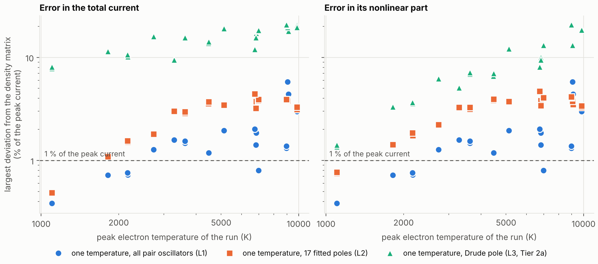
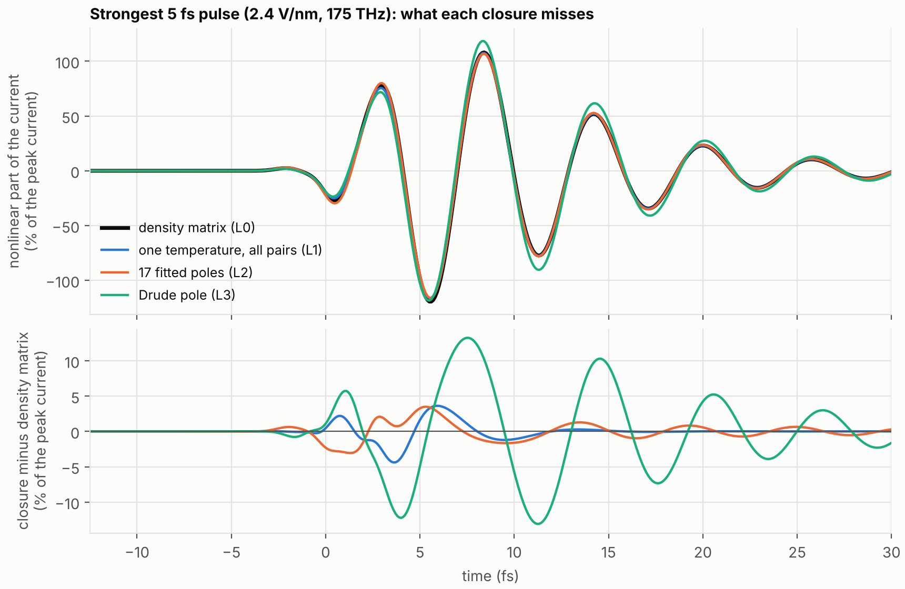

# Test GT2: is a learned few-cycle constitutive law worth building?

Generated by `scripts/make_closure_report.py` from `results/tier2/`. Do not edit by hand. Decision test requested by the project lead on 2026-11-24 ("option 1" of working-log session 5).

## Verdict

**No, not on the density-matrix model of [16, 62].** A learned operator would have to earn its place in one of three ways, and none holds here.

| Reason to learn an operator | Test | Result |
| --- | --- | --- |
| The microscopic model is too expensive to run in every cell | Wall time of the full density matrix | **Not the case.** 11 s per cell for a 60 fs window (32,640 oscillators, 600 collision evaluations) on 4 cores; about 18 min for 100 cells. Revision 2 of the plan assumed it was too expensive without measuring it |
| The response carries a memory that no simple state variable captures | Replace the populations by one number, the electron temperature (L1) | **Not the case.** The field-resolved current differs by at most 5.8 % of its peak (5 fs, 2.4 V/nm), median 1.3 %, while the response itself is nonlinear by 4–177 %. It exceeds 1 % in 18 of 26 conditions and 5 % in 1 |
| A compact fast law is needed and physics does not supply one | 17 fixed poles + one temperature (L2) | **Physics supplies it.** At most 4.4 % from the density matrix (5 fs, 2.4 V/nm), median 3.3 %, at 6 ms per cell |

What a trained operator could add at best is the gap between L1 and the density matrix: 1.3 % of the peak current in the median and 5.8 % in the worst case. The model itself is less certain than that. Two choices the papers leave open move its current by 4.5–12.7 % (section B), and it leaves out the coupling between coherences and every absorption channel of a film (`docs/theory/tier2_density_matrix.md` §5).

The test also produced three results that stand on their own:

1. **The plan's Tier 2a closure (one Drude pole) is not adequate for this particle**: 15.8 % median and 20.7 % worst error. Most of it is linear: a 4 nm particle absorbs through its size, which a Drude pole fitted at one frequency does not reproduce across a few-cycle bandwidth. With each model's own linear response removed, the Drude pole still misses up to 20.8 % of the peak current.
2. **A few-cycle law must let the damping follow the temperature in time.** The same 17 poles with temperature-independent widths fit χ(ω; T_e) as well at every frozen temperature, but in time they err by up to 13.2 % against 4.4 %: the electron temperature changes within the memory time of the polarisation. This is the non-adiabatic effect of the constitutive law, isolated.
3. **Eq. (16) of [16] is wrong as printed** and was reconstructed; with it the model reproduces the published results of [16, 62] to a few percent (section A).

## What was run

- Particle of [16, 62]: 4 nm ITO sphere in air, quasi-static field, parameters of [14, 15] (ITO (Sarkar/Un/Sivan 2023)), ε∞ = 3.32 fitted to Re ε(175 THz) = −1.6. Band of 8 eV on 256 points; the top cell never fills beyond 8e-06.
- 26 pulses: 175 THz with 5, 10, 20 fs duration and peak incident fields 0.3–2.4 V/nm, carrier-envelope phase 0 and π/2; two pulses at 230 THz. Peak electron temperatures 1100–9839 K.
- Truth L0: populations with e–e and e–ph collisions plus all pair oscillators. Closures: L1 = Fermi–Dirac populations at T_e(t); L2 = 17 fitted poles whose widths rise with the collision rate (9 poles and fixed widths as variants); L3 = one Drude pole. All closures are heated by the instantaneous work E_loc·Ṗ.
- Observable: the current J = Ṗ, which sets the field radiated by a thin layer of particles. "Error" is the largest deviation from L0 over the run, in percent of the peak of J. "Nonlinear part" is what remains after subtracting the scaled response to a weak pulse, for each model separately.

## A. The density-matrix model reproduces [16, 62]

`scripts/validate_densmat.py`; only ε∞ is adjusted.

| Quantity | [16] / [62] | this implementation |
| --- | --- | --- |
| ε(175 THz), 300 K | −1.6 + 1.4i | −1.60 (fitted) + 1.27i |
| Zero of Re ε | 215 THz | 214 THz |
| Energy given to the electrons, 1.2 V/nm | 0.63 eV/nm³ | 0.637 |
| Instantaneous absorbed power, 1.2 V/nm | −0.14 … +0.33 eV/nm³/fs | −0.147 … +0.343 |
| Local-field spectral peak at 0.4, 1.2, 2.4 V/nm | 178, 173, 168 THz | 176, 170, 166 THz |
| ε(160 THz) after the pump, 1.2 V/nm ([62] Fig. 4) | about −1.0 + 2.25i | −0.92 + 2.16i |
| 1/η_ee at E_F, 5 fs after the peak, 1.8 V/nm | about 12 fs | 14 fs |

The dipole element of [16] Eq. (16) gives -1.9e+05 times the required oscillator strength at E_F as printed; the reconstructed one gives 0.90 and matches [16] Fig. 1b away from the diagonal (log₁₀|D|² = -58.64 at 0.5 E_F against about -58.6 read from the figure). One disagreement remains: [62] quotes "∼4500 K" where this model has 6048 K for the same e–e time; the absorbed energies agree, and the e–e time fits the higher temperature.

## B. Closure errors, all conditions

Errors in percent of the peak current. "nonlin." is the size of the nonlinear part of the true response.

| f (THz) | τ (fs) | E₀ (V/nm) | CEP | T_e,max (K) | nonlin. | L1 | L2, 17 poles | L2, fixed widths | L2, 9 poles | L3 Drude | L3, nonlinear part only |
| --- | --- | --- | --- | --- | --- | --- | --- | --- | --- | --- | --- |
| 175 | 5 | 0.3 | 0 | 1101 | 4 | 0.4 | 0.5 | 0.4 | 9.3 | 7.8 | 1.4 |
| 175 | 5 | 0.3 | π/2 | 1100 | 4 | 0.4 | 0.5 | 0.4 | 9.3 | 8.1 | 1.4 |
| 175 | 5 | 0.6 | 0 | 2170 | 15 | 0.7 | 1.5 | 1.2 | 8.5 | 10.2 | 3.6 |
| 175 | 5 | 0.6 | π/2 | 2167 | 16 | 0.8 | 1.5 | 1.3 | 9.0 | 10.6 | 3.7 |
| 175 | 5 | 1.2 | 0 | 4468 | 46 | 1.2 | 3.6 | 3.4 | 7.7 | 13.7 | 6.6 |
| 175 | 5 | 1.2 | π/2 | 4474 | 46 | 1.2 | 3.7 | 3.3 | 8.3 | 14.2 | 7.0 |
| 175 | 5 | 1.8 | 0 | 6834 | 83 | 1.9 | 3.7 | 7.7 | 7.6 | 17.2 | 10.0 |
| 175 | 5 | 1.8 | π/2 | 6827 | 81 | 1.4 | 3.2 | 6.4 | 6.6 | 15.6 | 9.4 |
| 175 | 5 | 2.4 | 0 | 9118 | 119 | 4.4 | 3.7 | 11.7 | 5.6 | 18.0 | 13.3 |
| 175 | 5 | 2.4 | π/2 | 9060 | 114 | 5.8 | 3.8 | 13.2 | 6.0 | 19.5 | 13.1 |
| 175 | 10 | 0.3 | 0 | 1816 | 14 | 0.7 | 1.1 | 0.6 | 10.2 | 11.6 | 3.4 |
| 175 | 10 | 0.3 | π/2 | 1816 | 14 | 0.7 | 1.1 | 0.6 | 10.0 | 11.5 | 3.3 |
| 175 | 10 | 0.6 | 0 | 3616 | 42 | 1.5 | 2.9 | 1.6 | 8.8 | 15.5 | 6.9 |
| 175 | 10 | 0.6 | π/2 | 3619 | 43 | 1.5 | 3.0 | 1.7 | 8.9 | 15.6 | 7.1 |
| 175 | 10 | 1.2 | 0 | 6974 | 106 | 0.8 | 3.8 | 4.6 | 7.3 | 18.2 | 13.3 |
| 175 | 10 | 1.2 | π/2 | 6982 | 104 | 0.8 | 3.9 | 4.8 | 7.7 | 18.3 | 13.1 |
| 175 | 10 | 1.8 | 0 | 9839 | 160 | 3.0 | 3.1 | 9.3 | 6.4 | 20.6 | 19.2 |
| 175 | 10 | 1.8 | π/2 | 9839 | 161 | 3.0 | 3.3 | 8.8 | 6.8 | 19.6 | 18.5 |
| 175 | 20 | 0.3 | 0 | 2735 | 33 | 1.3 | 1.8 | 0.9 | 9.9 | 15.9 | 6.2 |
| 175 | 20 | 0.3 | π/2 | 2735 | 33 | 1.3 | 1.8 | 0.9 | 9.9 | 16.0 | 6.2 |
| 175 | 20 | 0.6 | 0 | 5131 | 86 | 1.9 | 3.5 | 1.6 | 8.3 | 19.3 | 12.1 |
| 175 | 20 | 0.6 | π/2 | 5131 | 86 | 1.9 | 3.4 | 1.6 | 8.4 | 19.1 | 12.1 |
| 175 | 20 | 1.2 | 0 | 8961 | 176 | 1.3 | 3.8 | 3.2 | 7.3 | 20.4 | 20.6 |
| 175 | 20 | 1.2 | π/2 | 8959 | 177 | 1.4 | 3.9 | 3.4 | 7.5 | 20.7 | 20.8 |
| 230 | 5 | 1.2 | 0 | 3282 | 27 | 1.6 | 3.0 | 2.1 | 9.4 | 9.4 | 5.1 |
| 230 | 5 | 2.4 | 0 | 6748 | 73 | 2.0 | 4.4 | 5.7 | 8.2 | 12.0 | 8.1 |

**How certain is the truth?** The same runs with two choices varied that [16, 62] do not fix, each recalibrated to the same cold permittivity: the regularisation constant of the dipole element lowered by 10 %, and only half of the e–e rate allowed to dephase the polarisation ([16] says the Umklapp share is unknown and of order one).

| τ (fs) | E₀ (V/nm) | L1 against the density matrix (%) | density matrix, c_reg 0.9 against 1.0 (%) | density matrix, half the e–e dephasing (%) |
| --- | --- | --- | --- | --- |
| 5 | 0.6 | 0.7 | 4.5 | 2.9 |
| 5 | 1.2 | 1.2 | 5.7 | 6.7 |
| 5 | 2.4 | 4.4 | 7.3 | 12.7 |
| 20 | 1.2 | 1.3 | 7.3 | 12.2 |

- The carrier-envelope phase changes the L1 error by at most 1.38 percentage points.
- Absorbed energy: within 2.3 % (L1), 2.1 % (L2) and 4.3 % (L3) of the density matrix.
- Third-harmonic amplitude of the current relative to the density matrix: 0.67–0.98 (L1), 0.71–1.27 (L2), 1.03–1.53 (L3). In this model the harmonics come from the 2ω ripple of the absorbed energy, which a temperature state carries.

**Other parameter set.** With Table S1 of [62] (D = 8.6 eV, Brooks–Herring impurities) the worst errors are 5.6 % (L1), 4.4 % (L2) and 20.5 % (L3): the same picture.

## C. Cost

| Model | State per cell | Wall time, 60 fs window (s) | 100 cells (min) |
| --- | --- | --- | --- |
| L0 density matrix | 256 populations + 32,640 oscillators | 10.8 | 18 |
| L1 one temperature, all pairs | 1 + 32,640 oscillators | 2.4 | 3.9 |
| L2 17 fitted poles | 1 + 17 oscillators | 0.006 | 0.01 |
| L3 Drude | 1 + 1 oscillator | 0.006 | 0.01 |

Measured on this 4-core machine with 0.02 fs steps; building the tables for the closures takes 29 s once per material.

## Consequences

- **Do not build the learned operator now.** The decision of Gate 1 carries over to the few-cycle regime: the microscopic model is cheap, and its reduction to one temperature plus a linear memory is accurate to a few percent and known in closed form.
- **Tier 2a should use the multi-pole form, not a single Drude pole, wherever the linear response is not Drude** (particles; films only if their dispersion requires it), and must make the pole widths follow the temperature. For bulk-like films the Drude pole is the right linear response, and the result here says the energy-balance part of Tier 2a is sound (absorbed energy within 4.3 %).
- **Nanocrystal experiments are now within reach without a film solver**: the validated particle model runs in seconds and applies directly to field-resolved measurements on ITO nanocrystals (Herbst et al. 2026, cited by [62]; not yet read).
- **Where learning could still enter:** not as a constitutive law, but as an emulator for inference over material parameters (option 2 of session 5), or later if the microscopic model gains physics that does not reduce to a temperature (coherence–coherence coupling, collision-assisted absorption in films). Neither exists yet.

## Limits

- One microscopic model, with the omissions listed in `docs/theory/tier2_density_matrix.md` §5. The test says a learned operator has nothing to learn from *this* model; it cannot speak for physics the model lacks.
- Uniform field in a 4 nm particle: no propagation, no film.
- The detection threshold of a field-resolved experiment is not known to me; errors are given in percent of the peak current so that any threshold can be applied.
- Pulses at 175 and 230 THz only; durations 5–20 fs; fields up to 2.4 V/nm (peak temperatures up to 9839 K).
